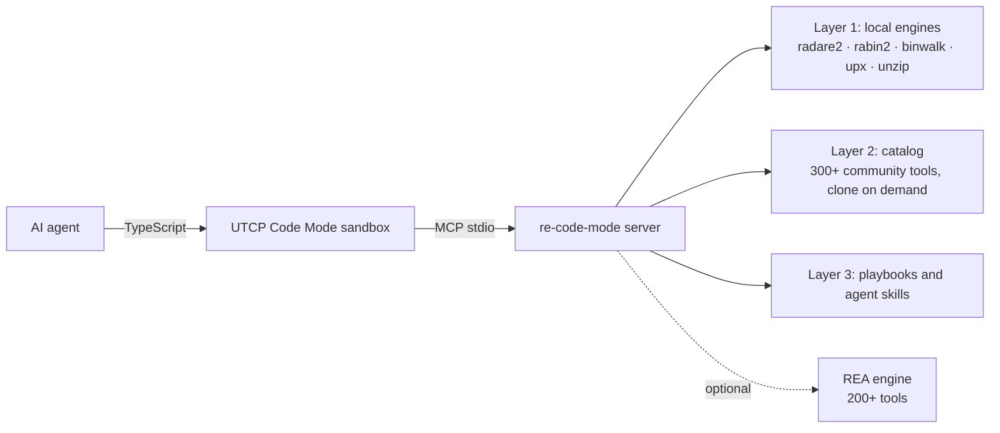

# re-code-mode

**A layered reverse-engineering toolbox for AI agents, served through [UTCP Code Mode](https://github.com/universal-tool-calling-protocol) so that big outputs are filtered inside a sandbox instead of flooding your model's context window.**

Disassembling a binary, listing imports or dumping strings can easily produce tens of thousands of lines. Classic MCP tool-calling pushes all of that into the model. With *Code Mode* the agent writes a few lines of TypeScript, the filtering happens locally, and only the answer comes back.

```ts
// one round-trip: triage + capability filter + selective strings
const t = await re.re_triage_binary({ path: "/samples/app" });
const imps = await re.re_imports_exports({ path: "/samples/app", filter: "socket|ssl|crypt", kind: "imports" });
const urls = await re.re_extract_strings({ path: "/samples/app", preset: "urls", limit: 10 });
return { arch: t.binary_info.arch, hardening: t.binary_info.security,
         net_imports: imps.imports.map(i => i.name), urls: urls.strings.map(s => s.string) };
```

> **Responsible use.** This project is for analysing software you own or are authorised to analyse: security research, malware triage, interoperability, CTFs, education. See [DISCLAIMER](#disclaimer) and [SECURITY.md](SECURITY.md).

## Architecture



| Layer | What it gives you |
|---|---|
| **1 – Engines** | `triage_binary`, `imports_exports`, `extract_strings`, `list_functions`, `disassemble_function`, `apk_inspect`, `firmware_scan` — all filtering happens server-side/in the sandbox. |
| **2 – Catalog** | `catalog_search`, `catalog_categories`, `fetch_tool`: a searchable index built from two public *awesome* lists, plus shallow clone of any entry on demand. |
| **3 – Playbooks & skills** | `get_playbook` (per target type), `skill_list` / `skill_read` over community agent skills you clone locally. |

Inside Code Mode every tool is prefixed with the manual name, so `triage_binary` is called as `re.re_triage_binary(...)`.

## Requirements

* Node.js ≥ 18, Python 3, git
* `radare2` (provides `r2`/`rabin2`), `binwalk`, `upx`, `unzip`, `file`
* Optional: `jadx`, `apktool`, `gdb`, `frida`

## Quick start

```bash
git clone https://github.com/sosiman/re-code-mode.git
cd re-code-mode
bash scripts/setup.sh --install-system-deps   # Debian/Ubuntu; on macOS: brew install radare2 binwalk upx
# optional extras
bash scripts/setup.sh --with-skills           # clone third-party agent skills into ./skills-repos
bash scripts/setup.sh --with-rea              # install the optional REA engine
npm test                                      # smoke + security regression tests

bin/re-run.sh list
bin/re-run.sh triage ./some-binary
```

`setup.sh` writes machine-local `.utcp_config.json` (git-ignored). If your npm blocks install scripts, approve `isolated-vm` (the V8 sandbox used by Code Mode) with `npm install-scripts approve`.

## CLI cheat-sheet (`bin/re-run.sh`)

```bash
bin/re-run.sh catalog "ghidra" 5          # search the tool catalog
bin/re-run.sh playbook android_apk        # methodology for a target type
bin/re-run.sh triage   ./bin              # arch, hardening, libs, SHA-256 (<1s)
bin/re-run.sh imports  ./bin "socket|ssl" # filtered imports/exports
bin/re-run.sh strings  ./bin "https?://"  # filtered strings
bin/re-run.sh funcs    ./bin "main|auth"  # functions (radare2 analysis)
bin/re-run.sh decompile ./bin main        # pdf + pdc for one function
bin/re-run.sh apk      ./app.apk apis     # framework fingerprint + endpoints from DEX
bin/re-run.sh firmware ./fw.bin           # embedded files + UPX check
bin/re-run.sh fetch    radareorg/radare2-mcp   # shallow clone into ./tools-cache
bin/re-run.sh skills android; bin/re-run.sh skill-read leanrea
bin/re-run.sh run 'return await re.re_catalog_categories({});'
```

All arguments are JSON-encoded before being placed in the generated TypeScript, so file names and patterns cannot inject code.

## Use it from an agent

Copy [`skills/re-code-mode`](skills/re-code-mode/SKILL.md) into your agent's skills directory (Claude Code, Gemini CLI, Codex, Hermes, … — anything that reads `SKILL.md`) and set `RE_CODE_MODE_HOME` to this checkout. The skill teaches the agent the workflow and the Code Mode idioms.

## Configuration (environment variables)

| Variable | Effect |
|---|---|
| `RE_CODE_MODE_HOME` | Override the project root (default: auto-detected). |
| `RE_ALLOWED_DIRS` | `:`-separated allow-list; analysed files must live under these directories. |
| `RE_ENABLE_REA_EXEC=1` | Expose the free-form `rea_exec` tool (off by default — REA can drive debuggers and devices). |
| `RE_KEEP_ALL_SKILLS=1` | Keep the offensive-security modules when cloning `reverse-skill`. |

## Security notes (short version)

* Run it **locally for a user you trust**; it is not a multi-tenant service.
* Analysing hostile samples with any disassembler is risky — use a VM/container.
* radare2 command injection, option injection in `git clone`, code injection through shell arguments and ReDoS are covered by tests in [`test/smoke.mjs`](test/smoke.mjs).

Full details and reporting instructions: [SECURITY.md](SECURITY.md).

## Third-party material

Nothing from the projects below is redistributed here. They are fetched on *your* machine, under *their* licences:

* Catalog sources: [zhuyansen/awesome-ai-reverse-engineering](https://github.com/zhuyansen/awesome-ai-reverse-engineering), [morluto/awesome-reverse-engineering](https://github.com/morluto/awesome-reverse-engineering)
* Skills (optional): [aicodeking/leanrea](https://github.com/aicodeking/leanrea), [SimoneAvogadro/android-reverse-engineering-skill](https://github.com/SimoneAvogadro/android-reverse-engineering-skill), [zhaoxuya520/reverse-skill](https://github.com/zhaoxuya520/reverse-skill)
* Engine (optional): [morluto/rea](https://github.com/morluto/rea) (`rea-agents` on npm)
* Runtime: [radare2](https://github.com/radareorg/radare2), [UTCP code-mode CLI](https://www.npmjs.com/package/@utcp/code-mode-cli), [Model Context Protocol SDK](https://github.com/modelcontextprotocol/typescript-sdk)

## Contributing

See [CONTRIBUTING.md](CONTRIBUTING.md). New engines, playbooks and fixes are welcome.

## Disclaimer

This software is provided for lawful, authorised security research, education and interoperability work. You are solely responsible for complying with applicable laws, licences and terms of service. The authors accept no liability for misuse. Do not use it to analyse systems or software you are not permitted to analyse.

## License

[MIT](LICENSE)
